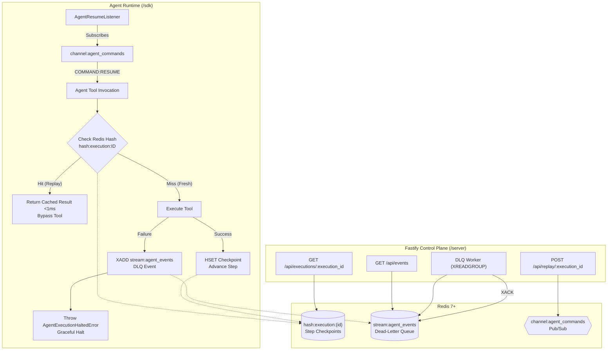

# AI Agent Checkpoint Replayer & Dead-Letter Queue (DLQ)

A production-ready, distributed recovery and checkpointing system for AI Agent workflows built with **Node.js**, **Fastify**, and **Redis (`ioredis`)**.

When external tools (APIs, third-party services, rate-limited LLM calls) fail during a multi-step agent execution, this architecture guarantees:
1. **Zero Redundant Compute:** Successfully completed steps are stored as immutable checkpoints in a Redis Hash (`hash:execution:{execution_id}`). Replaying resumes from the point of failure in `<1ms`, bypassing prior steps.
2. **Deterministic Dead-Letter Queue (DLQ):** Failed steps are trapped by the interceptor, packaged with execution metadata and stack traces, and appended to a persistent Redis Stream (`stream:agent_events`) via `XADD`.
3. **Graceful Halting:** Workflows halt safely with typed errors (`AgentExecutionHaltedError`), preventing cascading corruption.
4. **Decoupled Control Plane:** Operators trigger replays via HTTP `POST /api/replay/:execution_id`, which broadcasts `COMMAND:RESUME` via Redis Pub/Sub (`channel:agent_commands`).
5. **Real-Time DLQ Worker:** An asynchronous stream consumer worker continuously pulls failure events via `XREADGROUP`, alerts operators, and safely acknowledges processed records with `XACK`.

---

## 🏗️ Architecture Overview



---

## 📁 Repository Structure

```
DLQ-Replayer/
├── package.json               # Root dependencies and scripts
├── tsconfig.json              # TypeScript ESM configuration
├── docker-compose.yml         # Local Redis 7 & Redis Commander
├── .env.example               # Environment variables template
├── shared/                    # Core distributed systems primitives
│   ├── types.ts               # Shared schemas (Checkpoints, DLQ events, Commands)
│   ├── redis.ts               # Resilient ioredis client factory with role isolation
│   ├── logger.ts              # High-throughput structured Pino logger
│   └── index.ts               # Shared exports
├── sdk/                       # Lightweight Developer SDK
│   ├── package.json           # Standalone SDK package manifest
│   ├── interceptor.ts         # AgentCheckpointInterceptor (HGET/HSET/XADD)
│   ├── subscriber.ts          # AgentResumeListener (Pub/Sub COMMAND:RESUME)
│   ├── errors.ts              # AgentExecutionHaltedError & CheckpointStorageError
│   └── index.ts               # Public SDK interface
├── server/                    # Fastify Control Plane & DLQ Daemon
│   ├── package.json           # Standalone Server package manifest
│   ├── app.ts                 # Fastify instance builder & middleware
│   ├── index.ts               # Server entry point & graceful shutdown
│   ├── routes/
│   │   ├── replay.ts          # POST /api/replay/:execution_id
│   │   └── executions.ts      # GET /api/executions/:id & GET /api/events
│   └── workers/
│       └── dlq-worker.ts      # Stream consumer (XREADGROUP + XACK)
└── examples/
    ├── test-mock.ts           # Automated test suite (runs with ioredis-mock)
    └── simulate-agent.ts      # End-to-end interactive workflow simulation
```

---

## ⚡ Quickstart

### 1. Prerequisites
- **Node.js** v20+ or v24+
- **Redis** 7+ (or use Docker)

### 2. Start Redis (Docker)
```bash
docker compose up -d
```
*Redis will run on port `6379`. Redis Commander UI is available at `http://localhost:8081`.*

### 3. Install Dependencies
```bash
npm install
```

### 4. Run Automated Test Suite (No Redis Server Required)
```bash
npm test
```
*Executes unit and integration tests using `ioredis-mock` to verify checkpoint caching, HSET, and DLQ XADD operations.*

### 5. Start the Fastify Control Plane
```bash
npm run server
```
Server listens on `http://0.0.0.0:3000`.

### 6. Run the End-to-End Agent Simulation
In a separate terminal:
```bash
npm run agent:simulate
```

---

## 📦 Step 1: The SDK Interceptor (`/sdk`)

Wrap tool executions in your agent pipeline using `AgentCheckpointInterceptor`:

```typescript
import { createRedisClient } from './shared/redis.js';
import { AgentCheckpointInterceptor } from './sdk/interceptor.js';

const redis = createRedisClient('default');
const interceptor = new AgentCheckpointInterceptor(redis, {
  defaultTtlSeconds: 86400, // Checkpoint keys expire after 24h
});

// Step invocation inside your agent loop
const searchResult = await interceptor.executeStep({
  executionId: 'exec-alpha-101',
  stepIndex: 0,
  toolName: 'web_search',
  args: { query: 'Antigravity AI architecture' },
  execute: async (args) => {
    return await externalSearchApi(args.query);
  },
});
```

### Functional Middleware Alternative
```typescript
const wrappedSearch = interceptor.wrapTool('web_search', externalSearchApi);
const result = await wrappedSearch('exec-alpha-101', 0, { query: 'test' });
```

### Lifecycle Behavior:
1. **Cache Check (`HGET hash:execution:exec-alpha-101 0`)**:
   - If present: Returns parsed result immediately (`<1ms`). Tool is **not executed**.
2. **Tool Execution**:
   - Executes function and measures wall-clock duration.
3. **On Success (`HSET`)**:
   - Stores `ExecutionStepResult` in Redis Hash and refreshes TTL.
4. **On Failure (`XADD`)**:
   - Appends failure payload to `stream:agent_events`:
     ```json
     {
       "status": "STATUS:FAILED",
       "executionId": "exec-alpha-101",
       "stepIndex": "0",
       "toolName": "web_search",
       "errorMessage": "Rate limit exceeded (HTTP 429)",
       "errorTrace": "Error: Rate limit exceeded\n at ...",
       "timestamp": "2026-10-11T11:00:00.000Z"
     }
     ```
   - Throws `AgentExecutionHaltedError`, halting the agent gracefully.

---

## 🌐 Step 2: The Fastify Control Plane (`/server`)

### Endpoints

| Method | Endpoint | Description |
|---|---|---|
| `POST` | `/api/replay/:execution_id` | Publishes `COMMAND:RESUME` to `channel:agent_commands` |
| `GET` | `/api/executions/:execution_id` | Returns all completed checkpoints for an execution |
| `DELETE` | `/api/executions/:execution_id` | Clears stored checkpoints for cold restart |
| `GET` | `/api/events?count=20` | Returns recent DLQ failure events from the stream |
| `GET` | `/health` | Health and Redis connection status |

### Trigger a Replay
```bash
curl -X POST http://localhost:3000/api/replay/exec-alpha-101
```

Response:
```json
{
  "success": true,
  "message": "Replay command successfully dispatched to agent orchestrator",
  "executionId": "exec-alpha-101",
  "command": "COMMAND:RESUME",
  "subscribersNotified": 1,
  "existingCheckpointsCount": 2,
  "timestamp": "2026-10-11T11:15:00.000Z"
}
```

---

## 📡 Background DLQ Worker (`XREADGROUP`)

The control plane runs an asynchronous stream consumer:
```typescript
import { DlqWorker } from './server/workers/dlq-worker.js';

const blockingRedis = createRedisClient('blocking');
const worker = new DlqWorker(blockingRedis);
await worker.start();
```

- **Consumer Group Init:** Executes `XGROUP CREATE stream:agent_events dlq-consumers $ MKSTREAM`, safely ignoring `BUSYGROUP` errors.
- **Consumption Loop:** Polls via `XREADGROUP GROUP dlq-consumers consumer-1 COUNT 10 BLOCK 2000 STREAMS stream:agent_events >`.
- **Operator Logging:** Formats failure payloads into structured alert banners.
- **Acknowledgment:** Issues `XACK stream:agent_events dlq-consumers <id>` to prune the Pending Entries List (PEL).

---

## 🛡️ Distributed Systems Best Practices Implemented

1. **Redis Connection Isolation:**
   - `default` role: High-throughput multiplexed connection for `HSET`, `HGET`, `XADD`.
   - `subscriber` role: Dedicated connection for Pub/Sub `SUBSCRIBE` (which cannot execute data commands).
   - `blocking` role: Dedicated connection for `XREADGROUP ... BLOCK 2000` to prevent blocking web requests.
2. **At-Least-Once Delivery & ACK:** The DLQ worker acknowledges messages only after successful processing.
3. **Idempotency:** Step checkpoint writes in Redis Hash (`HSET`) are idempotent per `(execution_id, step_index)`.
4. **Memory Hygiene (TTL):** Checkpoint hashes include configurable TTL expiration to avoid unbounded memory growth.
5. **Clean Shutdown:** Hooks for `SIGINT` and `SIGTERM` stop workers, drain HTTP connections, and quit Redis sockets cleanly.
